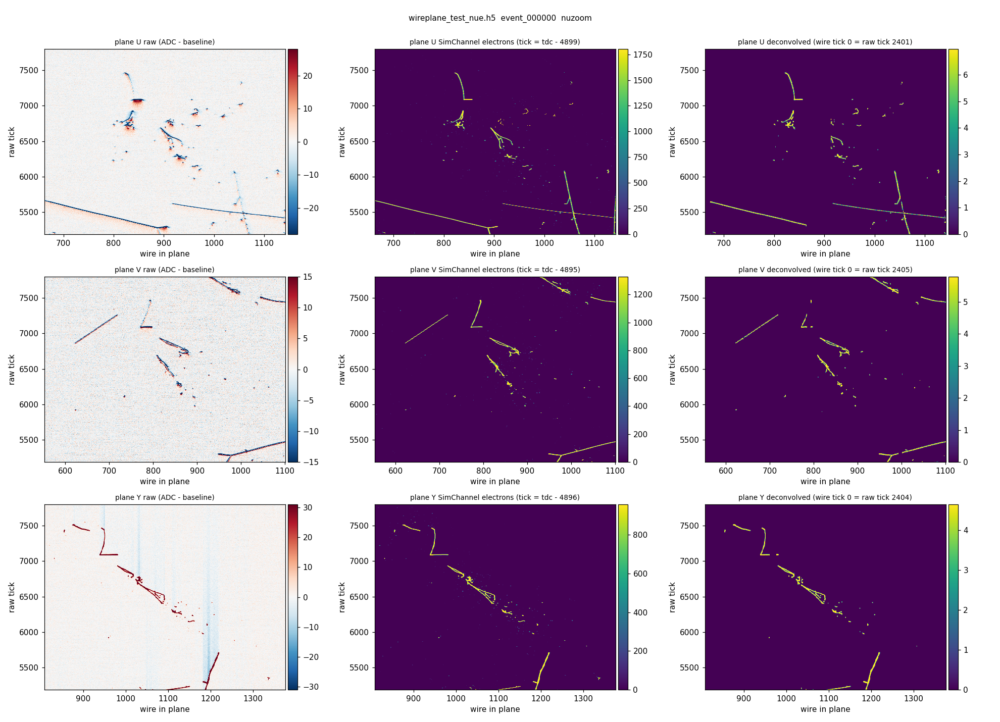
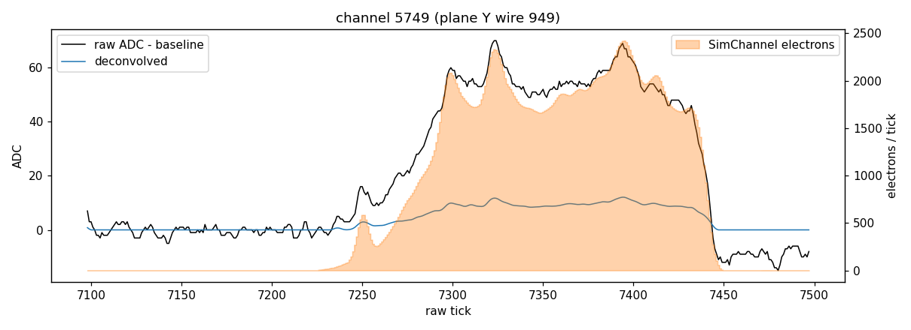
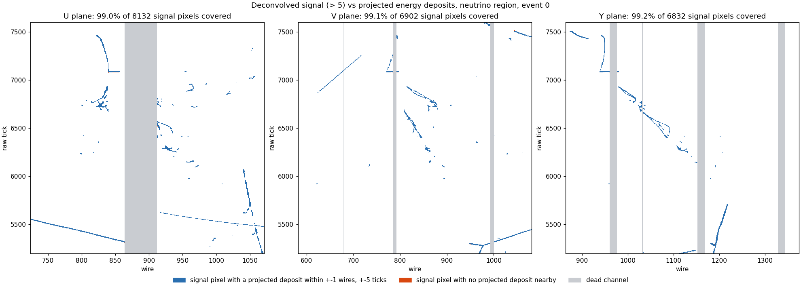
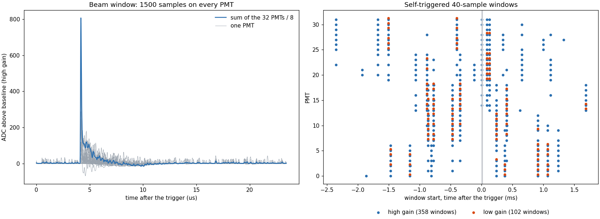

# wireplane_extract: raw wire-plane waveforms + truth from art files -> HDF5

Extracts, per event, the simulated raw TPC waveforms and the truth needed to label
them from a MicroBooNE LArSoft (art) file, for studies of 2D wire-plane encoders.

| HDF5 group | art product | default tag | what |
| --- | --- | --- | --- |
| `rawdigit` | `raw::RawDigit` | `driftWC:orig:Detsim` | simulated raw waveforms (field + electronics response, noise) |
| `wire` | `recob::Wire` | `butcher::McRecoStage1` | deconvolved waveforms, for comparison |
| `simch` | `sim::SimChannel` | `driftWC:simpleSC:Detsim` | ionization arriving at each wire: (channel, time, track, electrons) |
| `edep` | `sim::SimEnergyDeposit` | `largeant:TPCActive:G4EDep` | 3D energy deposits with track ID, **true** positions |
| `edep_sce` | `sim::SimEnergyDeposit` | `ionization::G4EDep` | the same deposits (same row order) after `ShiftEdepSCE`: positions displaced by the space-charge map, electron counts after recombination. This is the input of the WireCell drift |
| `chstatus` | `std::vector<int>` | `simnfspl1:badchannels` / `badmasks` (`McRecoStage1`) | dead-channel mask used by the signal processing |
| `opdet/<name>` | `raw::OpDetWaveform` | `pmtreadout:<instance>:Detsim`, `saturation:<instance>:McRecoStage1` | PMT waveforms: beam window and self-triggered windows, high and low gain |
| `particles` | `simb::MCParticle` | `largeant::G4EDep` | lookup table for the track IDs |

The input must be an art file that still has the detsim products (the `*_reco1.root`
or `*_postdlmctruth.root` of the chain in `../nu_and_cosmics`). The production
`dlmerged_*.root` files do **not** contain them; the production scripts delete the
art files.

## Running

On a compute node (inside a Slurm allocation):

```
bash install_py27_h5py.sh        # once: vendors h5py 2.10 for the stack's python 2.7 into py27_site/
bash run_extract_wireplane.sh <input_art.root> <output.h5> [extractor options]
```

`run_extract_wireplane.sh` starts the SL7 container with cvmfs (singcvmfs), sets up
`uboonecode v08_00_00_40a_dl -q e17:prof` (override with `UBOONECODE_VERSION`,
`UBOONECODE_QUAL`) and runs `extract_wireplane_h5.py`. Options: `-n`, `--start`,
`--*-tag` to change input tags (`--wire-tag ''` / `--particle-tag ''` to skip),
`--tdc-offset`, `--gzip`. `--opdet-tags` (name=label:instance:process list; `''` to skip). About 18 s and 80 MB per event on the test file.

Check an output file (python3 with h5py + matplotlib, e.g. the pointcept container):

```
python3 validate_wireplane_h5.py <output.h5> [-o plot_dir]
```

Check how completely the energy deposits label the images (needs
[pysbn-detinfo](https://github.com/NuTufts/pysbn-detinfo) with `project_to_image`; the
default looks for a clone in `../external/pysbn-detinfo`, and for the detinfo data in
`$PYSBN_DETINFO_PATH`, default `/cluster/tufts/wongjiradlab/larbys/detinfo`):

```
python3 check_edep_coverage.py <output.h5> [--plots plot_dir]
```

Summarize and plot the optical waveforms: `python3 check_opdet.py <output.h5> [--plots plot_dir]`.

Files: `check_edep_coverage.py`, `check_opdet.py`, `wireplane_products.cxx` (gallery reader, compiled with ACLiC on first use
into `build_<version>/`), `extract_wireplane_h5.py` (PyROOT driver, python 2.7),
`run_extract_wireplane.sh`, `install_py27_h5py.sh`, `validate_wireplane_h5.py`.

## Schema

File attributes: `source_file`, the input tags, `uboonecode_version`,
`extractor_git_commit`, `nevents`, `plane_first_channel = [0, 2400, 4800]`,
`plane_nwires = [2400, 2400, 3456]` (U, V, Y), `simch_tdc_to_tick_offset = 4900`,
`wire_tick0_raw_tick = 2400`.

One group per event, `event_%06d` (attrs `run`, `subrun`, `event`, `entry`):

| Dataset | Shape, type | Meaning |
| --- | --- | --- |
| `rawdigit/adc` | (8256, 9600) int16 | row = channel, column = tick (0.5 us). Pedestal NOT subtracted |
| `rawdigit/pedestal` | (8256,) float32 | nominal pedestal from the RawDigit (2046 U/V, 473 Y) |
| `rawdigit/sigma`, `present` | (8256,) | RawDigit sigma (0 in this sim); 1 if the channel was in the product |
| `wire/signal` | (8256, 6400) float32 | deconvolved signal, zero outside ROIs. Wire tick `t` = raw tick `t + 2400` |
| `simch/channel`, `tdc`, `track_id` | (N_IDE,) int32 | one row per IDE, sorted by channel then TDC |
| `simch/tick` | (N_IDE,) int32 | `tdc - 4900`: the raw tick at which the charge arrives |
| `simch/num_electrons`, `energy` | (N_IDE,) float32 | electrons collected; energy in MeV |
| `simch/x`, `y`, `z` | (N_IDE,) float32 | cm. **x is not the true drift position** (see below) |
| `edep/track_id`, `pdg` | (N_dep,) int32 | Geant4 track that made the deposit |
| `edep/energy` | (N_dep,) float32 | MeV |
| `edep/num_electrons`, `num_photons` | (N_dep,) int32 | not filled at this stage (-1 / 0): take them from `edep_sce` |
| `edep/start_xyz`, `end_xyz` | (N_dep, 3) float32 | cm, true position of the step (LArSoft world frame) |
| `edep/t_start`, `t_end` | (N_dep,) float64 | ns, Geant4 time |
| `edep_sce/*` | as `edep` | same rows; `start_xyz`, `end_xyz` displaced by space charge; `num_electrons` after recombination |
| `chstatus/dead` | (8256,) uint8 | 1 = channel in the bad-channel list |
| `chstatus/bad_channels` | (N_bad,) int32 | the list itself |
| `chstatus/bad_masks` | (N_bad, 3) int32 | (channel, first tick, last tick) masked; the whole readout (0-9592) for every bad channel |
| `opdet/<name>/channel` | (N_wf,) int32 | readout channel; PMT = `channel % 100` (0-31) |
| `opdet/<name>/timestamp` | (N_wf,) float64 | us, electronics time of the first sample. Trigger = 4050 us = Geant4 t = 0 |
| `opdet/<name>/nsamples`, `offset` | (N_wf,) int32, int64 | waveform `i` is `adc[offset[i] : offset[i] + nsamples[i]]` |
| `opdet/<name>/adc` | (sum of nsamples,) int16 | all waveforms concatenated; 15.625 ns per sample, baseline ~2048, 12 bit (saturates at 4095) |
| `particles/track_id`, `pdg`, `mother`, `status` | (N_part,) int32 | `mother` = 0 for primaries |
| `particles/ancestor` | (N_part,) int32 | track ID of the primary at the top of the mother chain |
| `particles/origin` | (N_part,) int32 | 1 = beam neutrino, 2 = cosmic (from the MCTruth) |
| `particles/truth_index` | (N_part,) int32 | index of the MCTruth the particle belongs to |
| `particles/process` | (N_part,) int32 | index into the `;`-separated attr `process_names` |
| `particles/energy`, `mass`, `momentum` | float32 | GeV at production; `momentum` is (N_part, 3) |
| `particles/start_xyz`, `end_xyz`, `t_start`, `t_end` | | cm, ns |

Conventions and things to know:

* **Track IDs.** `simch/track_id` and `edep/track_id` use the same ID space. A
  negative ID `-N` means the charge came from an EM-shower daughter that Geant4 did
  not store; it is attributed to stored particle `N`. Look up
  `abs(track_id)` in `particles/track_id` (100% of rows resolve on the test event).
* **Time alignment.** `simch/tick` is when the charge arrives. The raw waveform peak
  comes 1-5 ticks later (electronics shaping; measured lags 1/5/4 ticks on U/V/Y).
  The deconvolved signal lines up with `simch/tick - 2400` exactly.
  SimChannel TDCs cover the full 9600-tick readout.
* **SimChannel positions.** In the WireCell `simpleSC` SimChannels, `x` only takes
  ~10 discrete values between -0.6 and 0 cm (response/wire-plane positions); only
  `y` and `z` are deposit coordinates (after the space-charge displacement). For true
  3D positions use `edep` and project it into the image (next section).
* **Electron counts.** `simch/num_electrons` summed over a plane is the same for
  all three planes. On the test event 69.5% of the `edep_sce` electrons project inside
  the 9600-tick readout (the rest are out-of-time cosmics), and the SimChannels hold
  80.3% of those. The missing 20% is not broken down.
* **Dead channels are not in the raw waveforms.** In `driftWC:orig` every channel
  has noise and essentially every channel with truth charge shows signal. The
  bad-channel list is applied in reconstruction: `wire/signal` is empty on every
  channel of `chstatus/dead` (833 on the test event: 401 U, 98 V, 334 Y). To make
  raw input with realistic dead channels, mask `rawdigit/adc` rows with
  `chstatus/dead`. The list is the simulation's fixed list, taken from the
  `simnfspl1` noise-filter output of the same event.
* **Optical waveforms.** Two kinds of readout window, each in a high-gain and a
  low-gain copy (the low-gain signal is about 10x smaller, for pulses that saturate
  the high gain):

  | group | product instance | channels | content on the test event |
  | --- | --- | --- | --- |
  | `beam_highgain` | `OpdetBeamHighGain` | 0-31 | one 1500-sample (23.4 us) window per PMT starting at the trigger |
  | `beam_lowgain` | `OpdetBeamLowGain` | 100-131 | the same 32 beam windows at low gain, **plus** the low-gain self-triggered 40-sample windows (102) |
  | `cosmic_highgain` | `OpdetCosmicHighGain` | 200-231 | self-triggered 40-sample (0.6 us) windows, 358, from -2.4 to +1.7 ms around the trigger |
  | `cosmic_lowgain` | `OpdetCosmicLowGain` | | empty: this simulation files the low-gain self-triggered windows under `beam_lowgain`. Separate them by `nsamples` |
  | `beam_satcorr`, `cosmic_satcorr` | `saturation:*` (reco) | 0-31, 200-231 | high gain with saturated pulses replaced by the scaled low gain (values can exceed 4095). 50 of 358 cosmic windows differ from the raw high gain; no beam window does |

  Time of sample `k` relative to the trigger is `timestamp - 4050 + k * 0.015625` us,
  and that is also the Geant4 time (`particles/t_start`, `edep/t_start`, in ns / 1000).
  On the test event the summed beam-window light rises 0.03 us after the neutrino
  interaction time. The logic-pulse products (`BNBLogicPulse` etc.) and the
  reconstructed `OpHit` / `OpFlash` are not extracted.
* Noise differs by channel (sigma-clipped RMS about 1.5 to 2.5 ADC on most channels).

## Validation on the test file

`../nu_and_cosmics/prodgenie_bnb_intrinsic_nue_cosmic_uboone_..._reco1_postdlmctruth.root`
(1 event; despite the file name the neutrino interaction is a numu CC with a pi0).

Neutrino interaction region, raw / SimChannel truth / deconvolved per plane:



One collection-plane channel:



## Projecting the energy deposits into the images; label completeness

`check_edep_coverage.py` projects `edep` (true x, y, z, t) into (plane, tick, wire) with
`pysbn_detinfo`'s `DetInfo.project_to_image`, which applies the space-charge
displacement, the drift and the deposit time:

```python
from pysbn_detinfo import load
di = load("uboone")
mid = 0.5 * (edep["start_xyz"][:] + edep["end_xyz"][:]); t = 0.5 * (edep["t_start"][:] + edep["t_end"][:])
pr = di.project_to_image(mid, t, tick_offset=10)      # +10 ticks: this WireCell simulation
ch, raw_tick, ok = pr["channel"][:, plane], pr["row"][:, plane], pr["in_image"][:, plane]
# raw_tick indexes rawdigit/adc columns; wire/signal column = raw_tick - 2400
```

Results on the test event ([full report](figures/event_000000_coverage_report.txt)):

* **The projection is exact enough to label pixels.** The displaced positions equal the
  simulation's own (`edep_sce`) to 1e-4 cm. Per-track charge centroids of the projected
  deposits and of the SimChannels agree to 0.01 wire and 0.16 tick (spread), with a
  constant offset of 10.1 ticks. Without the space-charge step the spread is 6-9 wires
  (U, V) and 26 ticks.
* **Coverage of the image by labels**: fraction of signal pixels with a projected deposit
  within +-dw wires and +-dt ticks.

  | signal pixels | label | exact pixel | +-1 wire, +-2 ticks | +-1, +-5 | +-2, +-10 |
  | --- | --- | --- | --- | --- | --- |
  | deconvolved > 5, live channels (V, Y) | edep | 0.51, 0.54 | 0.97, 0.97 | 0.999, 0.999 | 1.000, 1.000 |
  | same | simch | 0.96, 0.96 | 0.998, 0.997 | 1.000, 1.000 | 1.000, 1.000 |
  | deconvolved > 5 (U) | edep | 0.46 | 0.88 | 0.91 | 0.92 |
  | raw, 5 sigma (U, V, Y) | edep | 0.21, 0.14, 0.32 | 0.64, 0.65, 0.80 | 0.80, 0.88, 0.91 | 0.93, 0.999, 0.997 |

  The deposits are points; the image signal is wider (diffusion, field response, the
  deconvolution filter), so exact-pixel coverage is about half and a few-pixel
  neighbourhood is needed. SimChannel labels already include the diffusion. The raw
  image needs a wider neighbourhood, mostly on the induction planes (bipolar,
  long-range induced signals).
* **The U deficit is one channel.** 4,500 of the 4,640 unlabeled U pixels are on channel
  446, a single live channel inside a block of dead ones, where the deconvolution
  returns one long ROI (ticks 400-6064, mean 19). Without it U matches V and Y.
* **Label efficiency**: fraction of projected electrons (inside the deconvolved window)
  with a signal pixel within +-1 wire, +-5 ticks: 0.92 / 0.96 / 0.98 (U / V / Y) on live
  channels. 19% / 5.5% / 5.6% of the electrons project onto dead channels, so over all
  channels it is 0.76 / 0.92 / 0.93. The rest on live channels is charge below the
  deconvolution's ROI threshold.



## Optical waveforms on the test event


